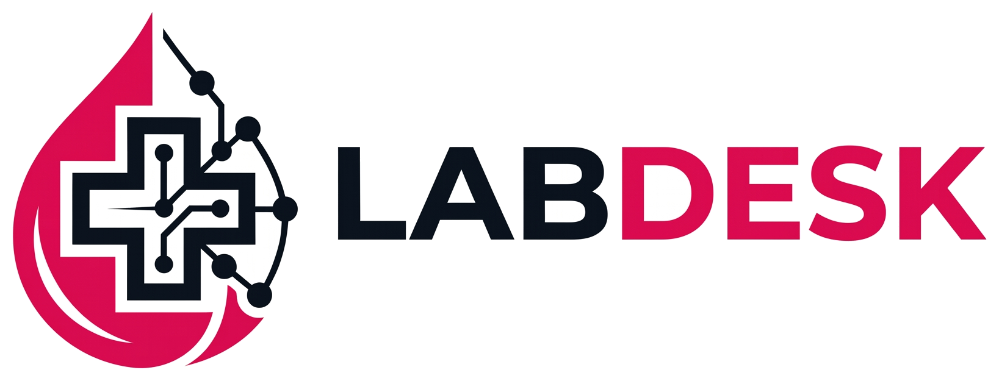

<p align="center"></p>

# LabDesk

**Lab software for Windows that works without the internet.** LabDesk registers patients, takes the results, prints bills and reports with a QR code and a verification reference, and keeps the day's money straight. It runs on one Windows PC and keeps everything in one SQLite file on that PC.

Made in Kashmir by [Syed Mutaib](https://github.com/mstudio005) for small pathology labs. Website and full manual: **<https://labdesk.mutaib.me>** (documentation at `/docs/`).

> **Status: beta.** LabDesk is being tested in a working lab. Read the [safety notice](#safety-notice) before using it for real patients.

## What it does

- **Patients and billing.** New, returning and quick registration; discounts; part payments; combined bills for several visits.
- **Results and reports.** Normal ranges by age and gender, HIGH / LOW / CRIT marks, calculated lines, partial approval, correction with a recorded reason, hand-over lock.
- **Printing.** Letterhead or plain paper, eight patient-box designs, doctor's signature, QR code and a short SHA-256 reference on every report. A scanner check says whether paper and records still match.
- **Roles.** Admin, Doctor, Technician, Front desk. Every action is written to an audit log that the program cannot edit.
- **Blood cell counter link.** Receives HL7 results from an analyzer on a TCP port, shows the values and graphs, and attaches them to a report. Nothing is approved automatically.
- **Analytics.** Visits, money, busy hours, payment methods, departments and tests.
- **Sharing.** Email (your own SMTP account) and WhatsApp Web through the optional [LabDesk Bridge](extension/README.md) browser extension. A person always presses Send.
- **Safe data.** Daily backups, optional password-locked backups (ChaCha20-Poly1305), cloud-folder copy, restore on a new PC, reversible deletes.
- **Offline first.** No server, no account, no telemetry. The internet is used only for update checks, email and WhatsApp Web, and only when you ask.

## Install

Download the latest installer from the [releases page](https://github.com/mstudio005/labdesk-releases/releases) and run it. Windows may show "Windows protected your PC" because the installer is not code-signed yet: press **More info**, then **Run anyway**. Installing a newer version over an older one is an update, and your data is never touched by the installer.

Requirements: Windows 10 or 11.

## Build from source

You need the stable [Rust toolchain](https://rustup.rs). The screens use [Slint](https://slint.dev) with the software renderer, so no GPU is needed.

```
cargo run -p labdesk-desktop --release -- --demo   # --demo adds sample tests on first start
cargo test -p labdesk-core                          # the rules, database and reports (no screen needed)
cargo test -p labdesk-desktop --lib                 # bridge and printing helpers
```

Tip: on a small machine add `-j 1` to keep memory use low.

Render every screen to PNG (used for the manual):

```
cargo run -p labdesk-desktop --example screenshot -- OUT_DIR [LETTERHEAD.png]
```

Where things are kept on a Windows PC:

| What | Where |
| --- | --- |
| Data file | `%LOCALAPPDATA%\LabDesk\lab.db` |
| Reports and bills | `Documents\LabDesk\Reports` |
| Backups | `Documents\LabDesk\Backups` |

To build the installer yourself see [Making a release](#making-a-release).

## Project layout

| Path | Contents |
| --- | --- |
| `crates/labdesk-core` | All lab rules, SQLite storage, calculations, PDF reports, backups, analyzer messages. No UI code. |
| `crates/labdesk-desktop` | The Slint screens, printing, the email sender and the local bridge server. |
| `extension/` | LabDesk Bridge, the browser extension for Chrome, Brave, Edge and Firefox. |
| `installer/` | The Inno Setup script. |
| `.github/` | Tests, release workflow, issue and pull request templates. |

Design rules that keep the code simple and safe: money is stored as integer paise; days follow Indian Standard Time; every function that changes data takes the signed-in person and checks their role first.

## Making a release

1. Commit and push to GitHub.
2. Tag a version and push the tag: `git tag v1.0.0 && git push origin v1.0.0`.
3. GitHub Actions runs the tests, builds `labdesk.exe`, wraps it in `LabDesk-Setup-<version>.exe`, writes a checksum and attaches both to a release.

The program checks that checksum before it installs an update. To get an installer without making a release, run the "Build Windows installer" workflow by hand from the Actions tab.

## Safety notice

LabDesk is software that helps people prepare laboratory reports. It is **not a certified medical device**. A qualified person must check every result and every report before it is used for a patient, exactly as with paper. Check normal ranges against your reagent and analyzer documentation. The software is provided without warranty (see the licence).

## Contributing

Bug reports, ideas and pull requests are welcome. Please read [CONTRIBUTING.md](CONTRIBUTING.md) first, and never post real patient data anywhere. To report a security problem privately see [SECURITY.md](SECURITY.md).

## Licence

LabDesk is free software under the **GNU General Public License, version 3 only** (see [LICENSE](LICENSE)). Copyright (C) 2026 Syed Mutaib. Third-party components and their licences are listed in [THIRD_PARTY_NOTICES.md](THIRD_PARTY_NOTICES.md).

The name **LabDesk** and the logo identify the original project. If you publish a modified version, please give it a different name and logo.
